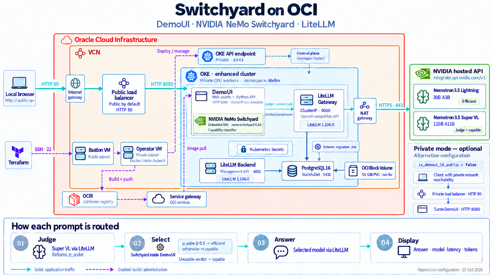

# Switchyard Demo on OCI

This repository deploys an NVIDIA NeMo Switchyard model-routing demo on Oracle
Cloud Infrastructure (OCI). A browser UI accepts a prompt, a judge estimates
whether the efficient model can answer it, and Switchyard selects the answer
model. The defaults use Nemotron 3.5 Lightning as the efficient model and
Nemotron 3.5 Super VL as both the capable model and judge. LiteLLM sends the
judge and answer requests to NVIDIA-hosted endpoints.

> [!WARNING]
> **The load balancer is public by default.** DemoUI is accessible from the
> internet over HTTP port 80 and has no user login. For private access, set
> `is_demoui_lb_public = false` in the `demoui-install` module call in `main.tf`
> before deployment. See [Access and upgrades](#access-and-upgrades) before
> changing an existing deployment.
>
> To restrict access, update `source = "0.0.0.0/0"` in the **“Allow HTTP access
> to demo UI load balancer”** Network Security Group rule in [`main.tf`](main.tf)
> to a trusted CIDR block, such as your public IP with `/32` or your organization's
> network range. This limits allowed clients while keeping the load balancer public.

## Architecture

Terraform provisions the infrastructure and coordinates application deployment:

- **Oracle Kubernetes Engine (OKE)** runs DemoUI, the LiteLLM gateway and
  management backend, and LiteLLM's PostgreSQL database.
- A **bastion host** provides SSH access into the private environment.
- An **operator host**, reached through the bastion, builds and pushes the demo
  image and runs the Helm and kubectl deployment steps invoked by Terraform.
- A **private OCI Container Registry (OCIR) repository** stores the demo UI image.
- An optional **OCI load balancer** exposes DemoUI on HTTP port 80 and forwards
  to application port 8080. The ClusterIP Service remains available for
  port-forward access.

The default request path is: browser → public load balancer → demo UI →
LiteLLM → NVIDIA-hosted models.

The diagram shows public access by default, with an inset for the alternative
private mode.

See [infrastructure composition](main.tf), [LiteLLM configuration](data/litellm-values.yaml),
and the [demo application](modules/deploy-demoui/demoui-app/demo-ui/app.py) for details.

## How to use

Before deployment, sign in to [NVIDIA Build](https://build.nvidia.com/) and
generate an NVIDIA API key from [API Keys](https://build.nvidia.com/settings/api-keys).
Enter it only at the deployment helper's hidden prompt.

Open Codex with this repository and say:

- **To deploy:** “Deploy this repository”
- **To destroy:** “Cleanup the resources”

The [deploy-repository skill](.agents/skills/deploy-repository/SKILL.md) guides you
through prerequisites and settings, then generates a command to run in your own
terminal. Exit Codex before running it and enter secrets only at the hidden
prompts. Review the Terraform plan and type `apply` for deployment or `destroy`
for cleanup to approve the changes.

After deployment, open the `demoui_access` URL, enter a prompt, and select
**Route & answer**. IP allocation can take several minutes; Helm waits up to
20 minutes, then Terraform reads the address through the OCI provider.

## Access and upgrades

Both public and private modes use `module.oke.pub_lb_nsg_id`, which permits TCP
traffic to the listener. Private mode requires a client with network access to
the load balancer's private address.

Address lookup matches the cluster compartment, attached NSG, and OCI freeform
tag `demoui_release=<namespace>/<release>`. New load balancers receive this tag
automatically, preserving cluster tag defaults. For an existing untagged load
balancer, add the tag in OCI (default: `demoui_release=litellm/demoui`), preserving
other tags. The annotation does not backfill existing resources; recreation is
unnecessary for tagging. Terraform rejects missing or ambiguous matches and
addresses with the wrong visibility.

Set `loadbalancer.enabled: false` in the [demo chart values](modules/deploy-demoui/demoui-app/charts/demo-ui/values.yaml)
to remove the load-balancer Service and use ClusterIP/port-forward access.
**Changing public/private mode requires recreation:** disable that Service and
apply, wait for deletion, then select the new mode, re-enable it, and apply again.

## Cleanup

Use the original checkout, backend, and active Terraform workspace/state;
cleanup removes resources tracked by that state. The demo module runs
`helm uninstall` on the operator before its registry or OKE infrastructure is
destroyed, waiting up to 20 minutes for release resources and finalizers,
including the load balancer. An absent release succeeds; connection, Helm, or
timeout failures stop cleanup for retry.

To remove only DemoUI, set `demoui_install = false` in the root module call and
apply through the plan-approval workflow. The hook removes only demo Helm release
resources; it leaves the shared namespace, separately created Secrets, LiteLLM,
and PostgreSQL. Its saved SSH key and the generated TLS key are sensitive Terraform
 state.

Keep Terraform state, backups, SSH keys, and credentials private. Never paste
secrets into chat or commit them to the repository.
